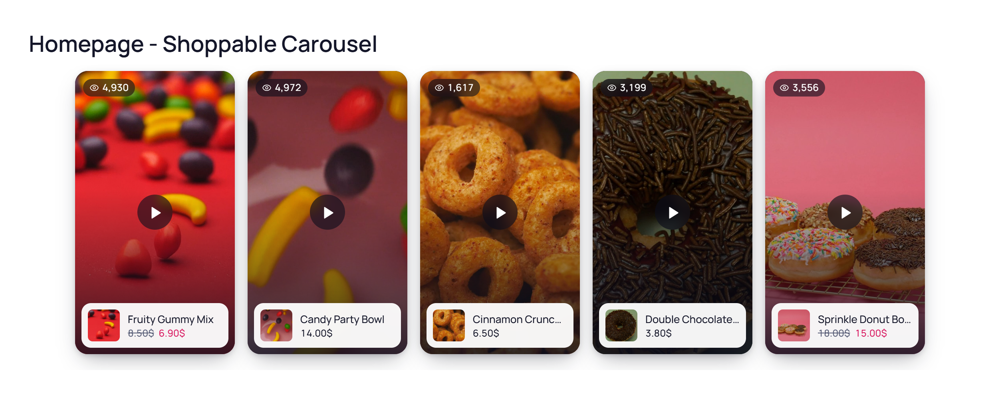

# ProductReels

**ProductReels** turns your product videos, customer UGC, reviews, tutorials and unboxings into interactive **shoppable video reels**. Tag WooCommerce products, show product cards over the video, and let shoppers add to cart without leaving the reel.

<figure><figcaption>
A reels carousel on a storefront: product cards sit on every video.
</figcaption></figure>


**100% free.** There is no Pro plan, license key or locked feature. Everything in this documentation is included.


## Watch the video tutorial


ProductReels in one minute: reels, widgets, layouts and statistics


## What you can do

<table data-view="cards"><thead><tr><th></th><th></th><th data-hidden data-card-target data-type="content-ref"></th></tr></thead><tbody><tr><td><strong>Add reels</strong></td><td>Upload videos or use YouTube Shorts and Vimeo, pick a cover and tag products.</td><td><a href="reels.md">reels.md</a></td></tr><tr><td><strong>Build widgets</strong></td><td>Pick a layout, style it with a live desktop, tablet and mobile preview.</td><td><a href="widgets.md">widgets.md</a></td></tr><tr><td><strong>Place them anywhere</strong></td><td>Shortcode, Gutenberg block, Elementor widget, or automatically on product pages.</td><td><a href="placing-widgets.md">placing-widgets.md</a></td></tr><tr><td><strong>Track results</strong></td><td>Views, clicks, click rate, orders and revenue for every reel.</td><td><a href="statistics.md">statistics.md</a></td></tr></tbody></table>

## Feature highlights

| Feature | What it gives you |
| --- | --- |
| **Shoppable video reels** | Tag WooCommerce products, show product cards and add to cart from a video. |
| **Five layouts** | Grid, carousel, marquee, stacked cards and floating popup, plus story-style round thumbnails. |
| **Product page reels** | Automatic placement on product pages, showing the videos tagged to the current product. |
| **Fullscreen player** | Mobile swipe, mouse wheel and keyboard navigation with video controls. |
| **Video sources** | WordPress Media Library, MP4, WebM, YouTube Shorts and Vimeo. |
| **Visual builder** | Live preview with desktop, tablet and mobile views. |
| **Analytics** | Views, clicks, click rate, eligible paid orders and attributed revenue. |
| **Lightweight** | Lazy-loaded videos, conditional assets and accessible controls. |


**Using WordPress without WooCommerce?** Video reels, galleries, custom buttons and analytics all work on standard WordPress sites. Product tagging and add to cart need WooCommerce.


## Start here

1. [Install and activate](getting-started.md) the plugin.
2. Follow the [Quick start](quick-start.md) to publish your first reels in about five minutes.
3. Explore [layouts](layouts.md) and [styling](styling.md) to match your brand.

## Live demos

See ProductReels working on a real site before you install it:

<table data-view="cards"><thead><tr><th></th><th></th><th data-hidden data-card-target data-type="content-ref"></th></tr></thead><tbody><tr><td><strong>ProductReels demo</strong></td><td>Every layout and the fullscreen player, live.</td><td><a href="https://bestwebexpert.com/productreels/">https://bestwebexpert.com/productreels/</a></td></tr><tr><td><strong>Reel layouts</strong></td><td>Preview every layout side by side.</td><td><a href="https://bestwebexpert.com/reel-layouts/">https://bestwebexpert.com/reel-layouts/</a></td></tr><tr><td><strong>Lookbook</strong></td><td>A shoppable lookbook built with reels.</td><td><a href="https://bestwebexpert.com/lookbook/">https://bestwebexpert.com/lookbook/</a></td></tr><tr><td><strong>Shop the look</strong></td><td>Tag products on a video and let shoppers buy the look.</td><td><a href="https://bestwebexpert.com/shop-the-look/">https://bestwebexpert.com/shop-the-look/</a></td></tr></tbody></table>


### Need help? Chat live or hire an expert

Our team at BestWebExpert is ready to help: **[start a live chat](https://bestwebexpert.com/)** or **[hire BestWebExpert](https://bestwebexpert.com/)** to set up, style or extend ProductReels for you.

