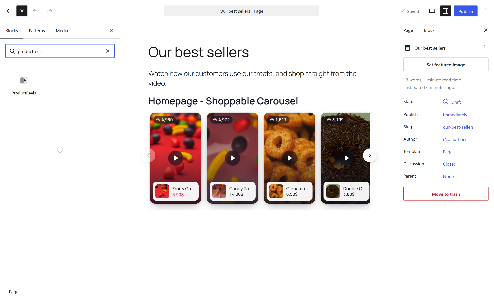
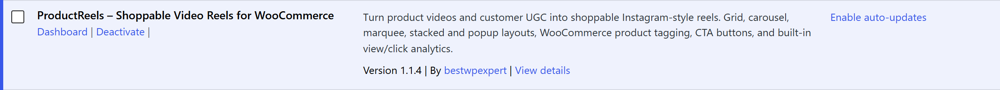
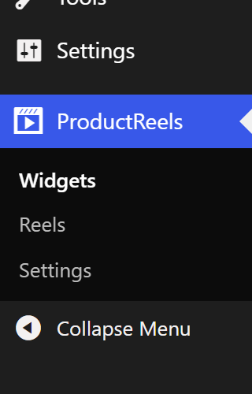
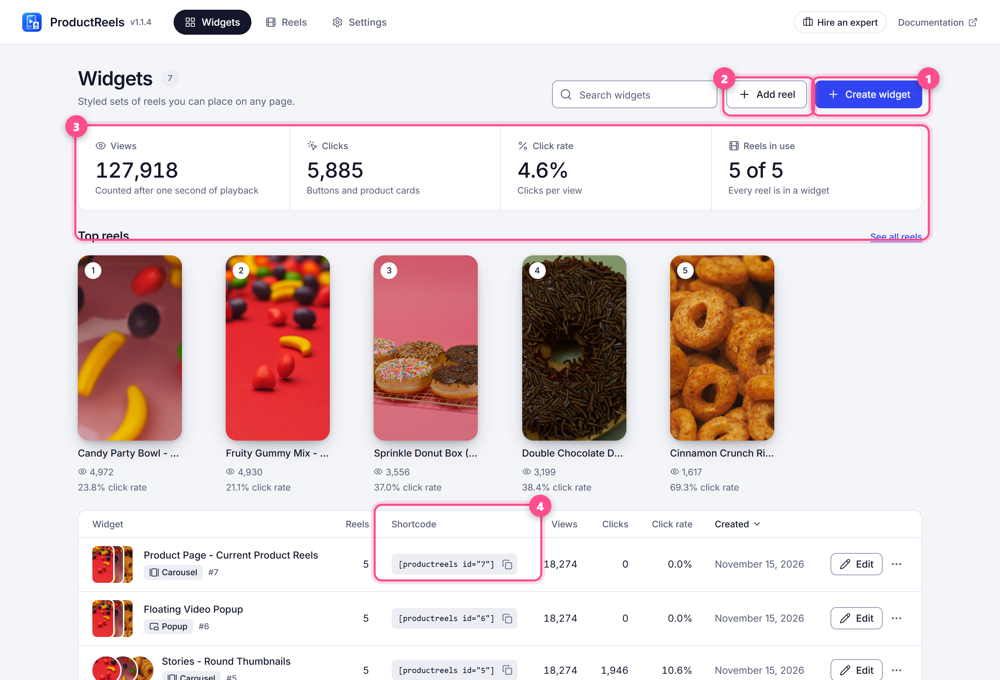

# Installation

## Requirements

| Requirement | Version |
| --- | --- |
| WordPress | 6.6 or newer (tested up to 7.1) |
| PHP | 7.4 or newer |
| WooCommerce | Optional. Needed for product tagging and add to cart. |

## Install from the WordPress dashboard

1. Go to **Plugins → Add New Plugin**.
2. Search for **ProductReels**.
3. Click **Install Now**, then **Activate**.

<figure><figcaption>
Once active, ProductReels is available as a block, a shortcode and an Elementor widget.
</figcaption></figure>


**Manual install:** upload the plugin folder to `/wp-content/plugins/productreels/` and activate it from **Plugins**.


On first activation WordPress takes you straight to the ProductReels dashboard. From the **Plugins** screen you can always jump back in with the **Dashboard** link next to the plugin name.

<figure><figcaption>
The <strong>Dashboard</strong> link on the Plugins screen opens ProductReels.
</figcaption></figure>

## Find your way around

ProductReels adds one menu to your WordPress sidebar with three destinations:

<figure><figcaption>
The ProductReels admin menu.
</figcaption></figure>

| Menu item | What it is for |
| --- | --- |
| **Widgets** | Create and style the reel collections you place on your pages. Also your overview of views and clicks. |
| **Reels** | Your video library: add videos, pick covers and tag products. |
| **Settings** | View counting, public API access, caching and uninstall behavior. |

<figure><figcaption>
The Widgets screen. <strong>1</strong> Create a widget · <strong>2</strong> Add a reel · <strong>3</strong> Totals across all widgets · <strong>4</strong> Copy a widget's shortcode.
</figcaption></figure>

## Two building blocks

ProductReels has two ideas. Once you know them, everything else follows.


**Reel**: one vertical video plus the products or buttons it sells. You build your library once and reuse each reel as often as you like.

**Widget**: a styled set of reels (a carousel, a grid, a popup and so on) that you place on a page.


Next: build your first widget in the [Quick start](quick-start.md).


### Need help? Chat live or hire an expert

Our team at BestWebExpert is ready to help: **[start a live chat](https://bestwebexpert.com/)** or **[hire BestWebExpert](https://bestwebexpert.com/)** to set up, style or extend ProductReels for you.

