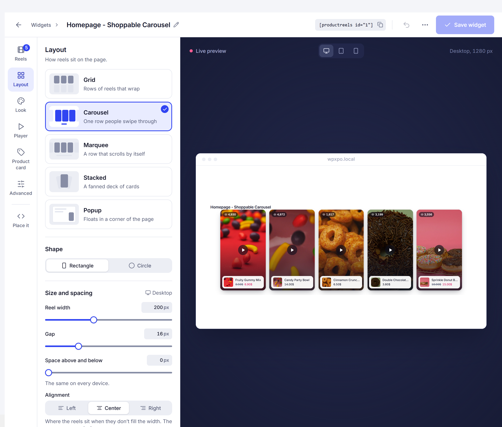
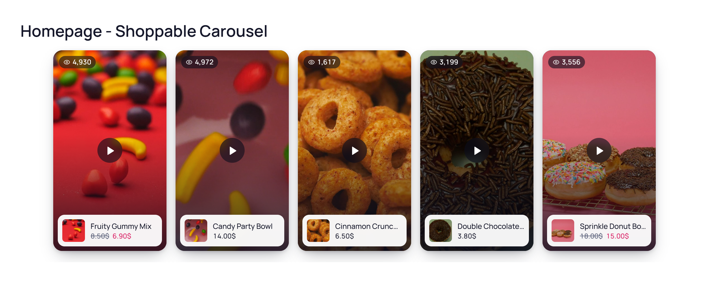
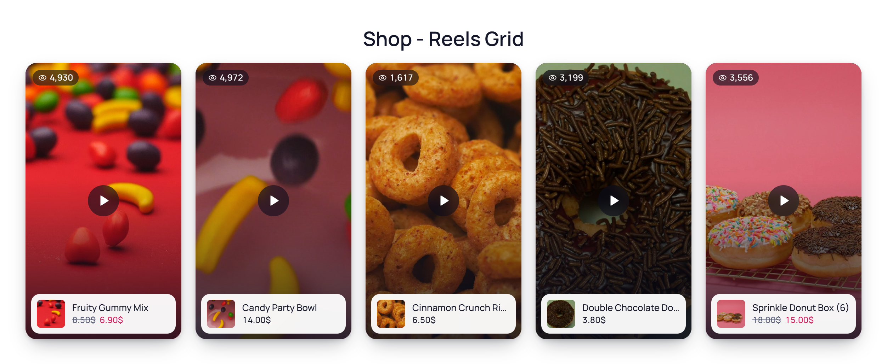
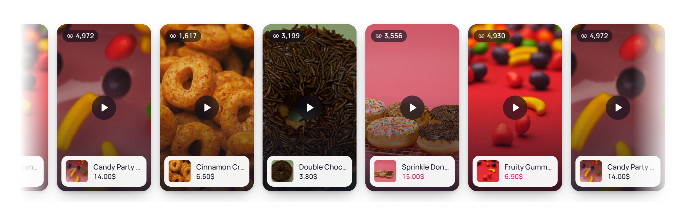
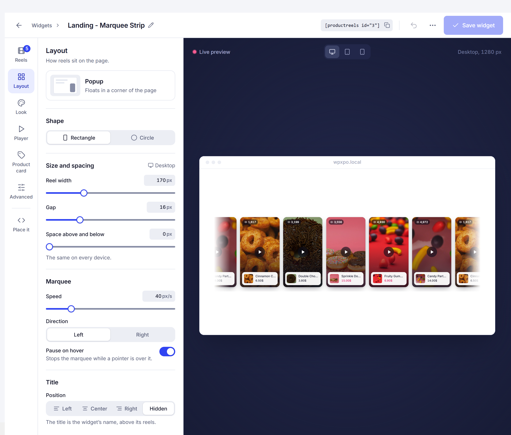
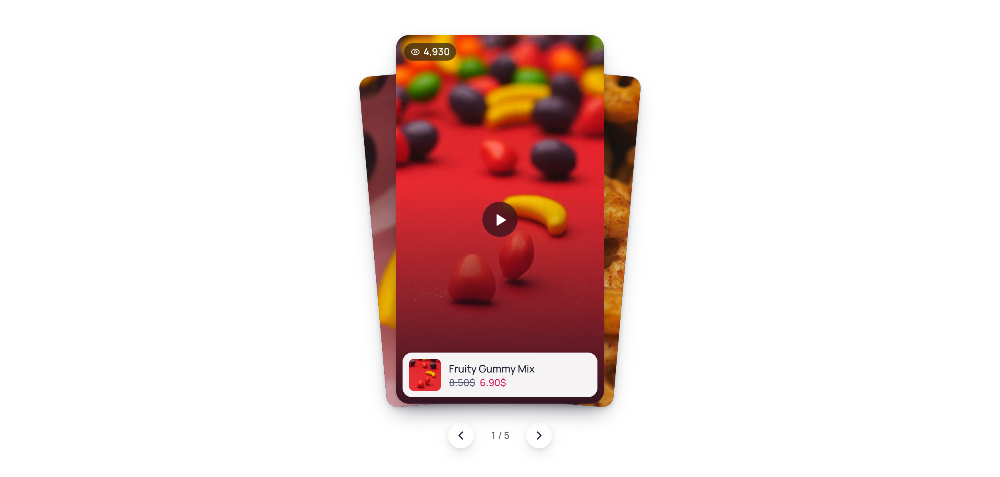
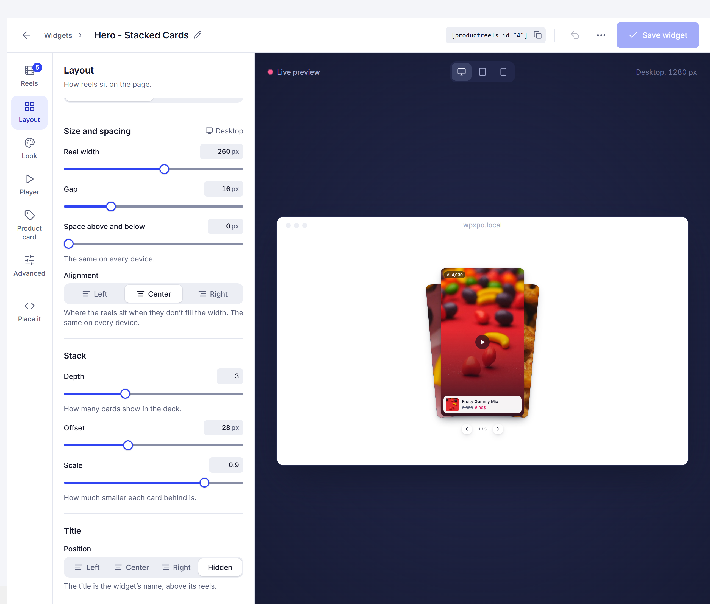
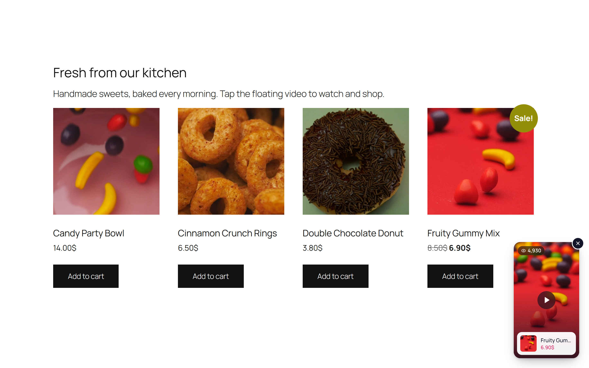
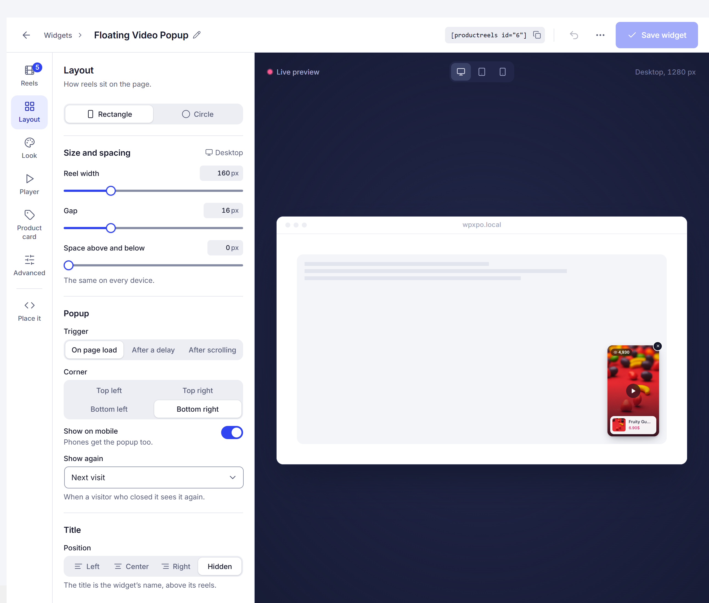
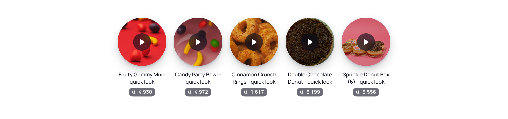

# Layouts

Pick a layout when you create a widget, or change it any time in the editor's **Layout** step. Your reels, products and statistics stay exactly as they are.

<figure><figcaption>
The <strong>Layout</strong> step: choose a layout, a shape and sizes.
</figcaption></figure>

## Choose the right layout

| Layout | Best for | Behavior |
| --- | --- | --- |
| [Carousel](layouts.md#carousel) | Homepages, category pages | One row that visitors swipe or scroll through. |
| [Grid](layouts.md#grid) | Shop pages, landing pages | Rows of reels that wrap. |
| [Marquee](layouts.md#marquee) | Banners, social proof strips | A row that scrolls by itself. |
| [Stacked](layouts.md#stacked-cards) | Hero sections | A fanned deck of cards. |
| [Popup](layouts.md#floating-popup) | Any page | A small video that floats in a corner. |
| [Story thumbnails](layouts.md#story-style-thumbnails) | Under headers, above product grids | Round thumbnails, like social stories. |

## Carousel

One row of reels that people swipe through. Navigation arrows sit **inside** or **outside** the row (set under [Styling → Player](styling.md#player)).

<figure><figcaption>
Carousel.
</figcaption></figure>

## Grid

Reels in rows that wrap to fit the available width.

<figure><figcaption>
Grid, with a centered widget title.
</figcaption></figure>

## Marquee

A continuously scrolling strip, ideal for a social-proof banner.

<figure><figcaption>
Marquee.
</figcaption></figure>

Marquee options:

| Option | What it does |
| --- | --- |
| **Speed** | How fast the strip scrolls, in pixels per second. |
| **Direction** | Scroll **Left** or **Right**. |
| **Pause on hover** | Stops the marquee while a pointer is over it. |

<figure><figcaption>
Marquee settings in the Layout step.
</figcaption></figure>

## Stacked cards

A fanned deck: the front card is the active reel, with the others peeking out behind. Shoppers flip through with arrows.

<figure><figcaption>
Stacked cards with navigation arrows and a counter.
</figcaption></figure>

Stacked options let you control how many cards are visible behind the front one (depth), how far each is offset, and how much each shrinks (scale).

<figure><figcaption>
Stacked settings in the Layout step.
</figcaption></figure>

## Floating popup

A compact video that floats in a corner of the screen and does not take any space in your page content.

<figure><figcaption>
A floating popup in the bottom-right corner.
</figcaption></figure>

<figure><figcaption>
Popup settings.
</figcaption></figure>

| Option | What it does |
| --- | --- |
| **Trigger** | **On page load**, **After a delay** (set the number of seconds) or **After scrolling** (set the scroll percentage). |
| **Corner** | Top left, top right, bottom left or bottom right. |
| **Show on mobile** | Turn off to hide the popup on phones. |
| **Show again** | How long a closed popup stays hidden for that visitor: for the page, the session, a day, a week or a month. |


A popup is placed like any other widget, with its shortcode or block. Put it on the pages where you want it to appear. See [Placing widgets](placing-widgets.md).


## Story-style thumbnails

Choose the **Circle** reel shape (in the **Layout** step, or when you create the widget) to get round, story-style thumbnails. The screenshot below uses a carousel. Pair it with the title shown **below** the reel (**Look → Title → Below**) for the classic story look.

<figure><figcaption>
Round thumbnails with titles and view counts below.
</figcaption></figure>

## Size, spacing and devices

The **Layout** step also controls:

* **Reel width**: how wide each reel is.
* **Gap**: the space between reels.
* **Space above and below**: breathing room around the widget.
* **Widget title**: show the widget's name above the reels, aligned left, center or right, or hide it.

Reel width and gap can be set separately for **Desktop**, **Tablet** and **Mobile**: switch device in the preview, then adjust.


**Not sure which layout will convert best for your store?** Ask on [live chat](https://bestwebexpert.com/) or [hire BestWebExpert](https://bestwebexpert.com/) for a tailored recommendation.

