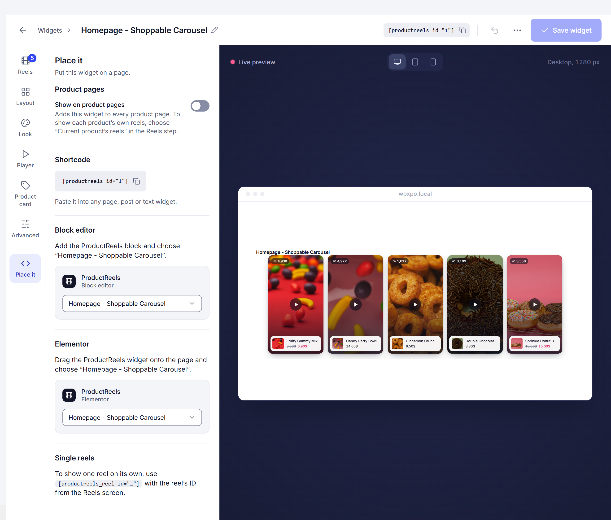
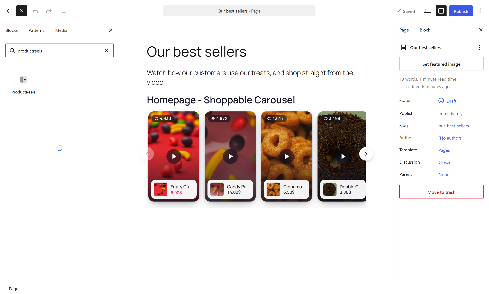
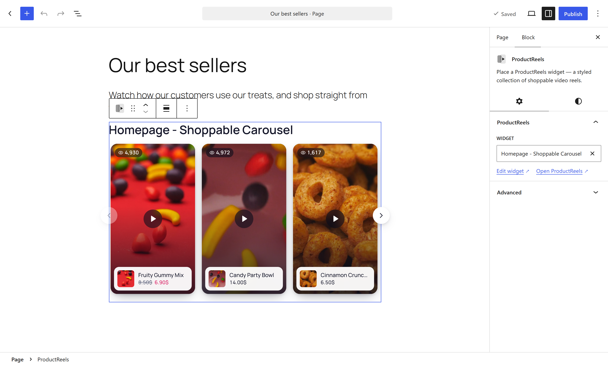

# Placing widgets

There are four ways to show a widget. All of them produce exactly the same result, so choose whichever fits your workflow.

The editor's **Place it** step lists them all, with your widget's real shortcode and name filled in.

<figure><figcaption><p>The <strong>Place it</strong> step: shortcode, block editor and Elementor.</p></figcaption></figure>



Paste this into any page, post or text widget:

```
[productreels id="1"]
```

Replace `1` with your widget's ID. The easiest way to get it right: click the **copy** icon next to the shortcode in the Widgets list or the editor.

| Attribute | Required | What it does |
| --- | --- | --- |
| `id` | Yes | The widget to show. |
| `product` | No | For widgets that show the **current product's reels**: names the product whose reels to show. Useful on a landing page that is not that product's own page. |

```
[productreels id="7" product="37"]
```

### Show one single reel

To show a single reel with no widget around it, use `productreels_reel`:

```
[productreels_reel id="3"]
```



1. In the block editor, click **+** to open the inserter.
2. Search for **ProductReels** and add the block.
3. In the block sidebar, choose your **Widget**.

<figure><figcaption><p>Search for <strong>ProductReels</strong> in the inserter.</p></figcaption></figure>

<figure><figcaption><p>Choose the widget in the sidebar. <strong>Edit widget</strong> and <strong>Open ProductReels</strong> are one click away.</p></figcaption></figure>

The block supports **wide** and **full** width alignment and block margins.



1. Open the page in Elementor.
2. Search the widget panel for **ProductReels**.
3. Drag it onto the page and choose your **Widget** from the dropdown.


The Elementor widget appears automatically when Elementor is active. Nothing else to install.




Show a widget automatically on **every WooCommerce product page**, with no shortcode on each product. See [WooCommerce product pages](product-pages.md).



## What happens if something is wrong

If the widget ID is missing or does not exist, **administrators** see a short notice in place of the widget (for example *"ProductReels: widget #12 was not found."*). Visitors see nothing, so a broken shortcode never shows an error to your customers.


**Only loads when needed.** ProductReels adds its scripts and styles only to pages that contain a widget. Pages without reels load nothing extra.



**Need a hand placing widgets in a complex theme or page builder?** [Live chat](https://bestwebexpert.com/) is available, or [hire BestWebExpert](https://bestwebexpert.com/).

