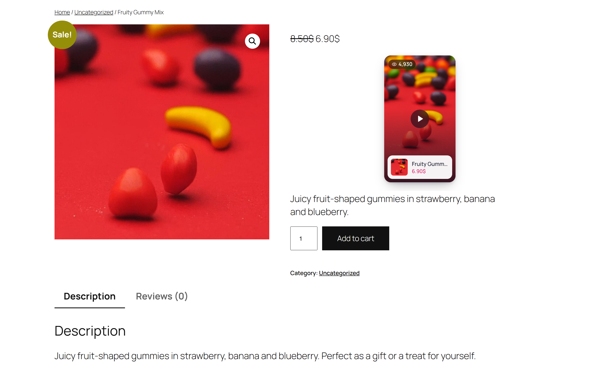
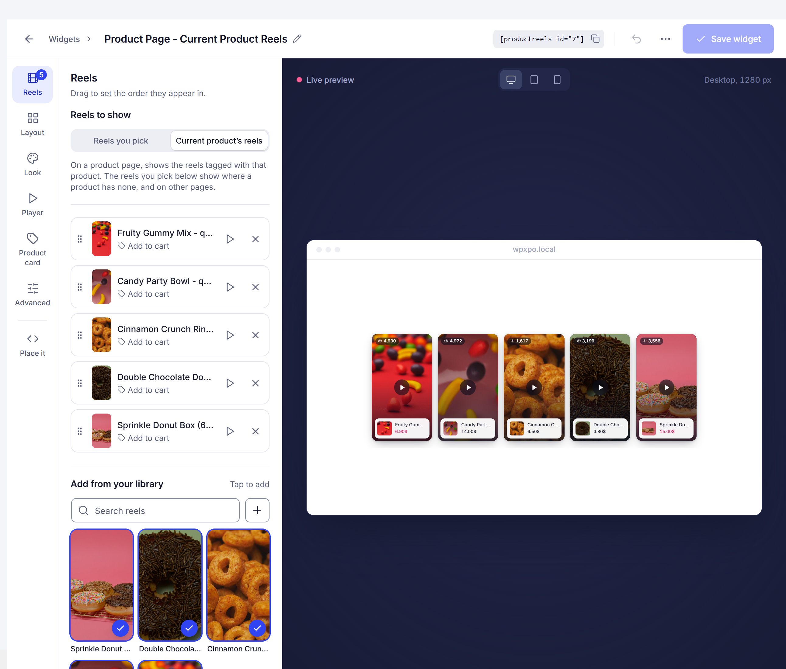
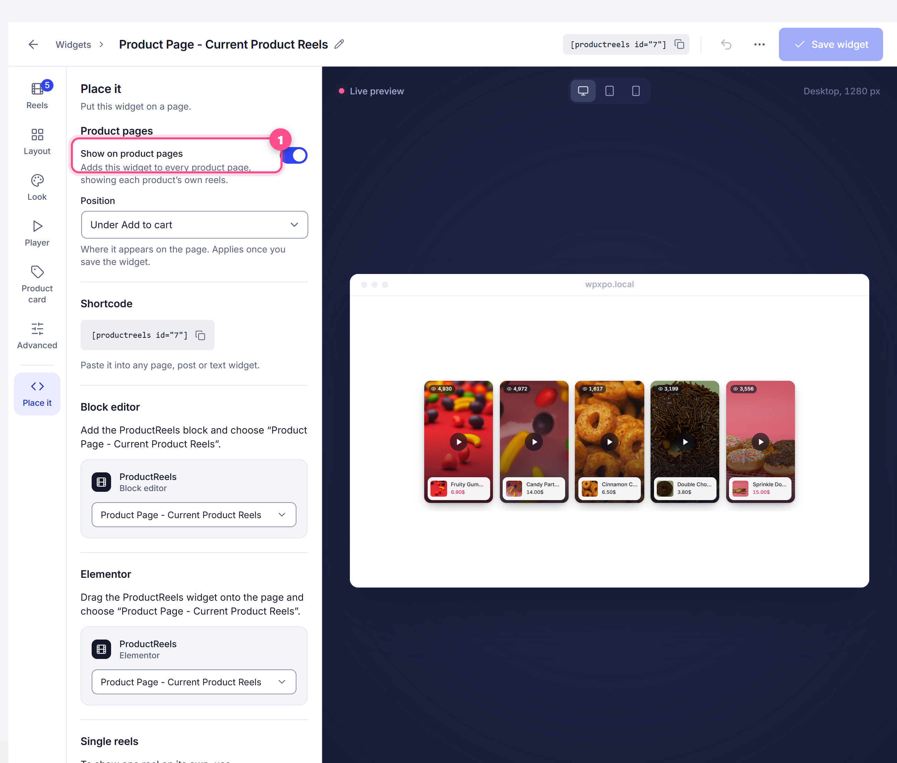
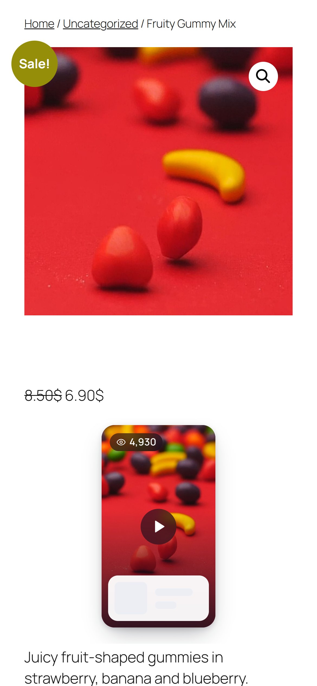

# WooCommerce product pages

ProductReels can place a widget on **every product page** and fill it with the reels that are **tagged with that product**. Tag a reel once and it shows up on the right product page by itself.

<figure><figcaption><p>A reel on a product page, placed under the <strong>Add to cart</strong> button.</p></figcaption></figure>

## Set it up



### Tag your reels with products

In **ProductReels → Reels**, open a reel and tag the product it features in **Shop this reel**. See [Reels](reels.md#shop-this-reel).



### Show the current product's reels

Create or open a widget. In the **Reels** step, under **Reels to show**, choose **Current product's reels**.

<figure><figcaption><p>On a product page the widget shows the reels tagged with that product. The reels you pick below are the <strong>fallback</strong>.</p></figcaption></figure>


**Fallback reels.** The reels you pick in the list show wherever a product has no tagged reels, and on pages that are not product pages. So a product page is never empty.




### Turn on product-page placement

Open the **Place it** step, switch on **Show on product pages** and choose a **Position**.

<figure><figcaption><p><strong>1</strong> Switch on automatic placement and pick where it appears.</p></figcaption></figure>

Choose from five positions around the product, for example **Under Add to cart**. The change applies once you **save the widget**.



## On mobile

The same reels work on small screens, and tapping one opens the swipe player.

<figure><figcaption><p>The product page on a phone.</p></figcaption></figure>

## Use it on a landing page

Not every page that features a product is that product's own page. Use the shortcode's `product` attribute to name the product whose reels to show:

```
[productreels id="7" product="37"]
```


Product placement needs **WooCommerce**. Each widget is placed independently, so you can have different widgets in different positions.



**Want product-page reels set up across your whole catalog?** Chat with us at [bestwebexpert.com](https://bestwebexpert.com/) (**live chat available**) or [hire BestWebExpert](https://bestwebexpert.com/).

