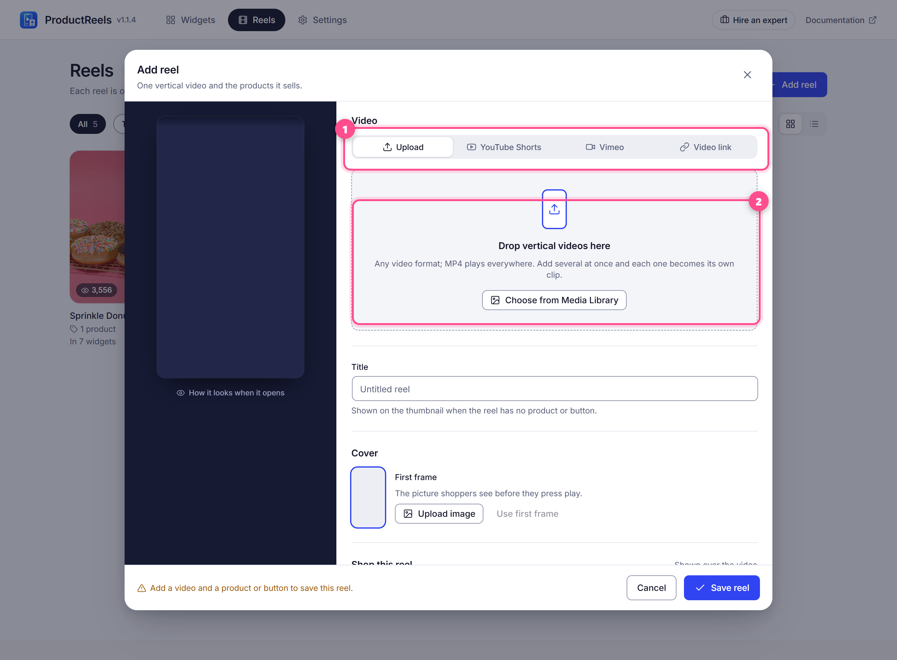
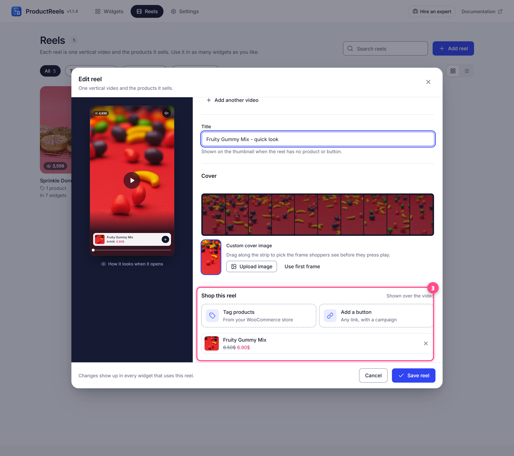
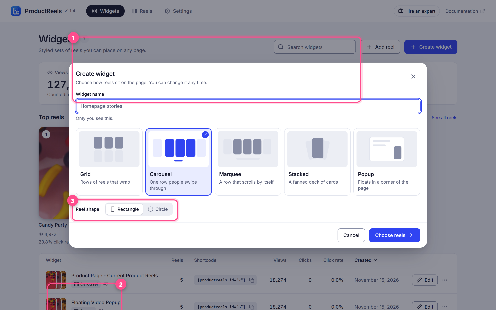
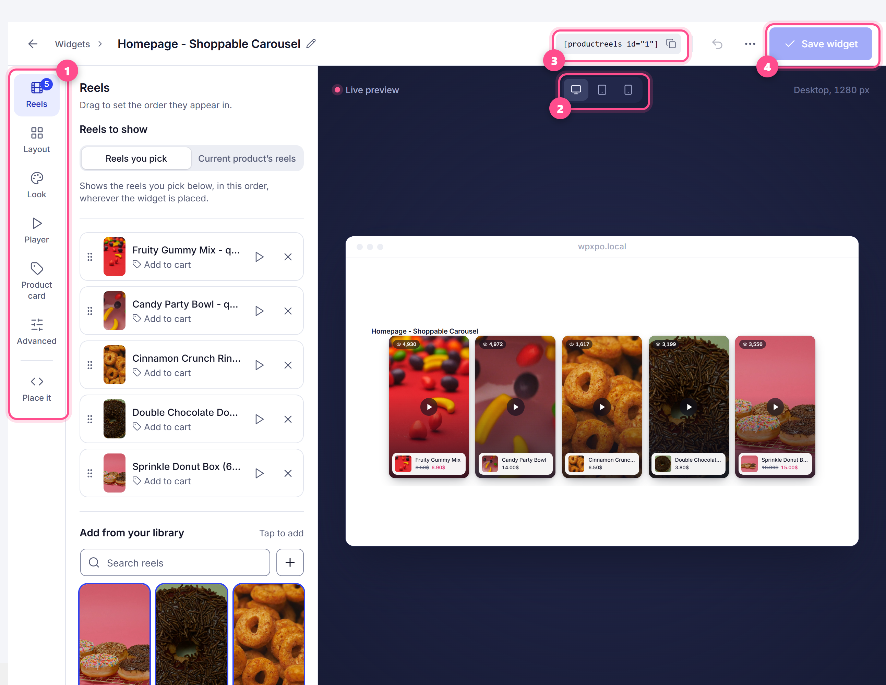
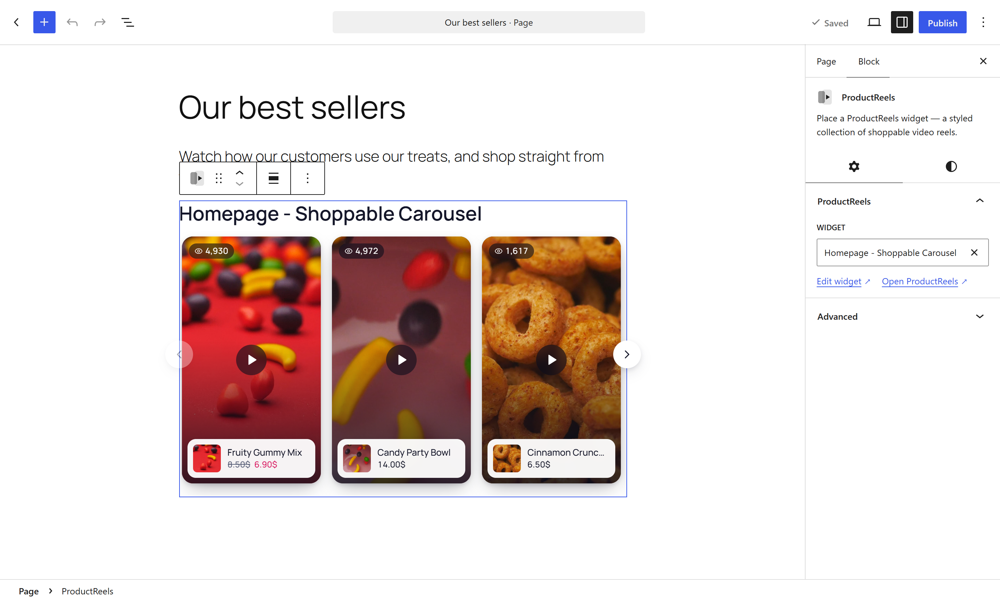
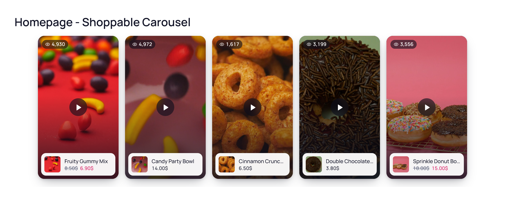

# Quick start

This walkthrough takes about five minutes. You will add a reel, build a widget, style it and put it on a page.

Prefer to watch? Here is the one-minute video tutorial:


ProductReels video tutorial




### Add your first reel

Go to **ProductReels → Reels** and click **Add reel**.

<figure><figcaption>
<strong>1</strong> Choose where the video comes from · <strong>2</strong> Drop a file or pick one from the Media Library.
</figcaption></figure>

Add a vertical video, then choose what the reel sells in the **Shop this reel** section: tag a WooCommerce product or add a custom button.

<figure><figcaption>
A tagged product appears as a product card on the video.
</figcaption></figure>

Click **Save reel**. [Read more about reels →](reels.md)



### Create a widget

Go to **ProductReels → Widgets** and click **Create widget**. Name it, choose a layout, and pick the reels to show.

<figure><figcaption>
<strong>1</strong> Name (only you see it) · <strong>2</strong> Layout · <strong>3</strong> Reel shape.
</figcaption></figure>

Not sure which layout to choose? Start with **Carousel**. You can change it at any time. [Compare layouts →](layouts.md)



### Style it with the live preview

The widget editor shows a live preview as you change settings. Use the **Desktop / Tablet / Mobile** switch to check every screen size.

<figure><figcaption>
<strong>1</strong> Settings steps · <strong>2</strong> Device preview · <strong>3</strong> Shortcode · <strong>4</strong> Save.
</figcaption></figure>

Click **Save widget** when you are happy. [Styling options →](styling.md)



### Place it on a page

Copy the widget's shortcode (for example `[productreels id="1"]`) and paste it into any page, post or text widget. Prefer blocks? Add the **ProductReels** block and choose your widget.

<figure><figcaption>
The ProductReels block with its widget picker in the sidebar.
</figcaption></figure>

Publish the page, and your reels are live. [All placement options →](placing-widgets.md)



## What shoppers see

<figure><figcaption>
Your finished widget on the page.
</figcaption></figure>

Tapping a reel opens the [fullscreen player](shopper-experience.md), where shoppers can swipe through videos and add products to the cart.


### Need help? Chat live or hire an expert

Our team at BestWebExpert is ready to help: **[start a live chat](https://bestwebexpert.com/)** or **[hire BestWebExpert](https://bestwebexpert.com/)** to set up, style or extend ProductReels for you.

