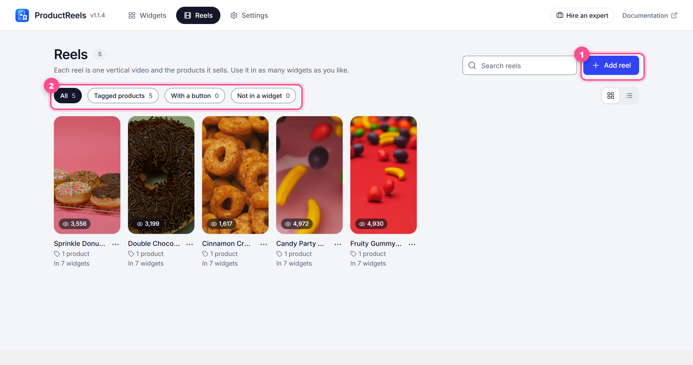
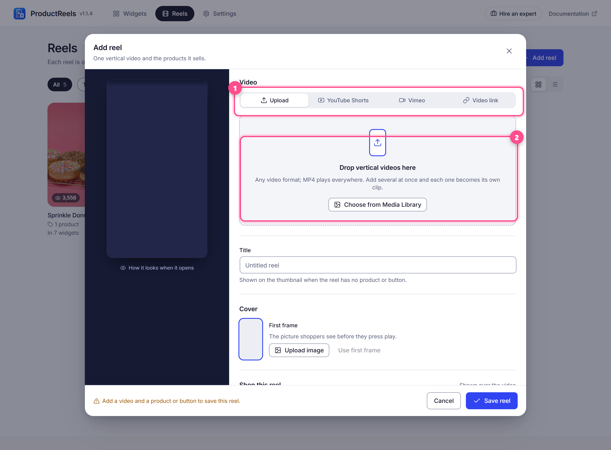
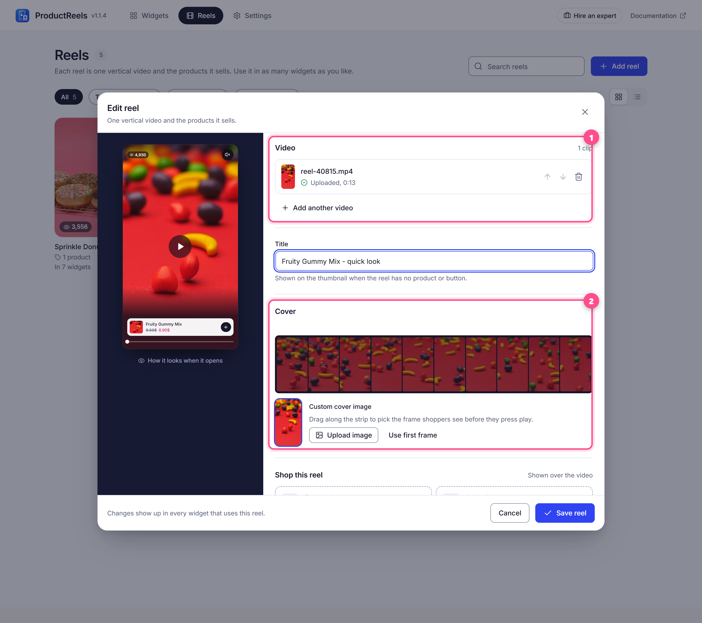
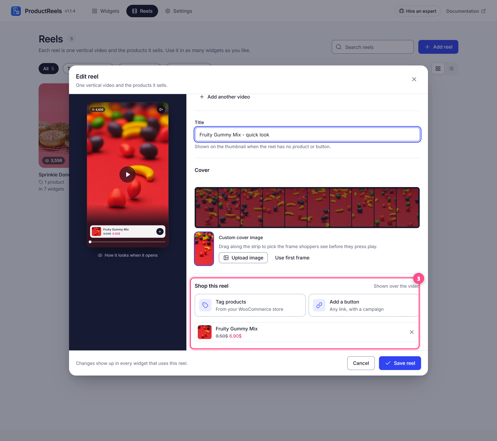

# Reels

A **reel** is one vertical video together with the products or buttons it sells. Build your library once, then reuse any reel in as many widgets as you like. Editing a reel updates it everywhere.

## The reels library

Open **ProductReels → Reels** to see your library.

<figure><figcaption>
<strong>1</strong> Add a reel · <strong>2</strong> Filter your library · <strong>3</strong> Switch between grid and list view.
</figcaption></figure>

Each card shows the cover, the number of views, how many products are tagged and how many widgets use the reel. Use the **⋯** menu on a card for more actions, and the search box to find a reel by name.

### Filters

| Filter | Shows |
| --- | --- |
| **All** | Every reel in the library. |
| **Tagged products** | Reels with at least one WooCommerce product. |
| **With a button** | Reels with a custom button. |
| **Not in a widget** | Reels that are not used anywhere yet. Handy for finding forgotten videos. |

## Add a reel

Click **Add reel**. Choose one of four video sources:

<figure><figcaption>
The Add reel dialog.
</figcaption></figure>

| Source | Use it when |
| --- | --- |
| **Upload** | You have an MP4 or WebM file. Drop it in, or choose one from the **Media Library**. Any video format is accepted, but MP4 plays everywhere. |
| **YouTube Shorts** | Your video already lives on YouTube Shorts. |
| **Vimeo** | Your video lives on Vimeo. |
| **Video link** | You have a direct link to a hosted MP4 or WebM file. |


You can add several videos at once. Each one becomes its own clip, and a single reel can hold more than one clip. Use **Add another video** to build a multi-clip reel.



ProductReels does not import TikTok or Instagram reels automatically. Upload videos you own as MP4 files, or use YouTube Shorts, Vimeo or hosted MP4/WebM links.


## Edit a reel

Click any reel in the library to open the editor. A live phone preview on the left shows how the reel looks when it opens.

<figure><figcaption>
<strong>1</strong> Videos in this reel · <strong>2</strong> Cover selection.
</figcaption></figure>

### Videos

The **Video** section lists every clip in the reel. Use the arrows to reorder clips and the bin to remove one.

### Title

The title is shown on the thumbnail when the reel has no product or button. It is also how you recognize the reel in your library.

### Cover

The cover is the picture shoppers see before they press play. You have two options:

* **Pick a frame**: drag along the filmstrip to choose a moment from the video. **Use first frame** resets it.
* **Upload image**: use your own cover from the Media Library.

## Shop this reel

This is what turns a video into something shoppable.

<figure><figcaption>
<strong>3</strong> Tag products or add a button. Tagged products appear as product cards.
</figcaption></figure>



Choose **Tag products** to pick items **from your WooCommerce store**. Each tagged product shows as a product card on the video, with its image, name and price (including sale price), and an add-to-cart control.

Requires WooCommerce. If WooCommerce is turned off, the editor shows a notice with a link to your Plugins screen.



Choose **Add a button** to link to **any URL**. Works without WooCommerce. For each button you can set:

| Field | Purpose |
| --- | --- |
| **Button text** | The label shoppers see. |
| **URL** | Where the button goes. |
| **Open in new tab** | Keep your page open while the link loads. |
| **Campaign name** | A label so you can tell buttons apart in [statistics](statistics.md). |
| **Custom CSS class** | Style the button with your own CSS. |




A reel needs **a video and at least one product or button** before **Save reel** becomes available.



### Need help? Chat live or hire an expert

Our team at BestWebExpert is ready to help: **[start a live chat](https://bestwebexpert.com/)** or **[hire BestWebExpert](https://bestwebexpert.com/)** to set up, style or extend ProductReels for you.

