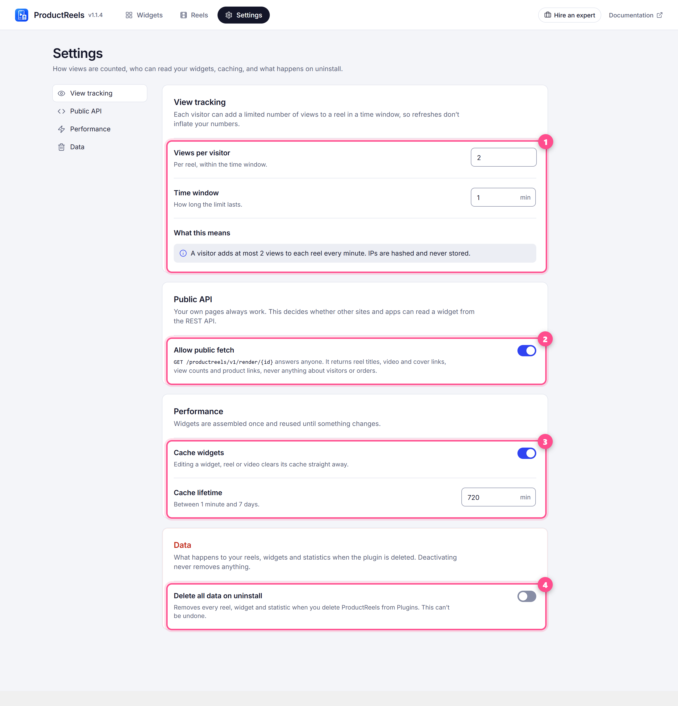

# Settings

Open **ProductReels → Settings**. The defaults suit most stores, so you only need to visit this page for specific needs.

<figure><figcaption>
<strong>1</strong> View tracking · <strong>2</strong> Public API · <strong>3</strong> Performance · <strong>4</strong> Data.
</figcaption></figure>

Click **Save settings** after making changes. ProductReels warns you if you try to leave with unsaved changes.

## View tracking

Each visitor can add a limited number of views to a reel inside a time window, so page refreshes do not inflate your numbers.

| Setting | Default | Range |
| --- | --- | --- |
| **Views per visitor** (per reel, within the time window) | 2 | 1 to 100 |
| **Time window** | 1 minute | 1 to 1,440 minutes |

With the defaults, a visitor adds at most 2 views to each reel every minute. The settings page shows a plain-language summary under **What this means**.


Visitor IP addresses are **hashed with your WordPress salts and never stored**.


## Public API

| Setting | Default |
| --- | --- |
| **Allow public fetch** | On |

Your own pages always work. This setting decides whether **other sites and apps** can read a widget from the REST API at `GET /productreels/v1/render/{id}`. It returns reel titles, video and cover links, view counts and product links. It **never** returns anything about visitors or orders.

Turn it off if you do not need to expose widget data outside your own site.

## Performance

| Setting | Default | Range |
| --- | --- | --- |
| **Cache widgets** | On | n/a |
| **Cache lifetime** | 720 minutes (12 hours) | 1 minute to 7 days |

Widgets are assembled once and reused until something changes. **Editing a widget, reel or video clears its cache straight away**, so you never have to clear it manually.

## Data

| Setting | Default |
| --- | --- |
| **Delete all data on uninstall** | Off |

Deactivating the plugin never removes anything. By default, **deleting** the plugin also keeps your data, so reinstalling brings everything back.


Switch on **Delete all data on uninstall** only if you want deleting the plugin to remove every reel, widget and statistic from your database. **This cannot be undone.**



**Questions about caching, security or performance tuning?** [Live chat](https://bestwebexpert.com/) is available, or [hire BestWebExpert](https://bestwebexpert.com/) to review your setup.

