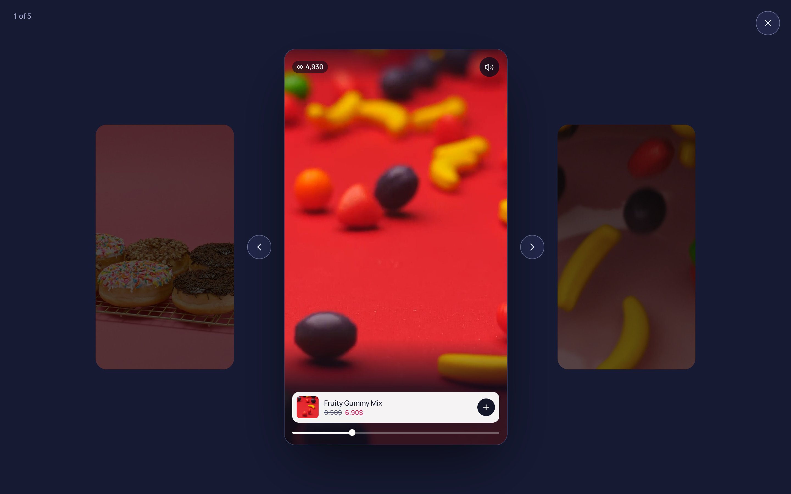
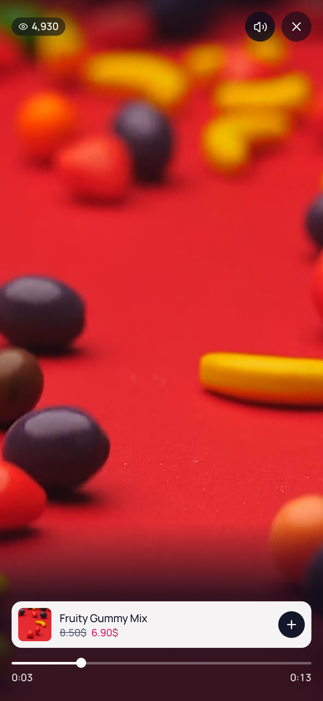
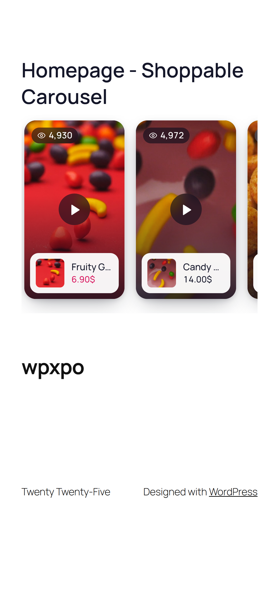

# The shopper experience

When a shopper taps a reel, ProductReels opens a **fullscreen player** where they can swipe through your videos and shop, without leaving the page.

## On desktop

<figure><figcaption>
The fullscreen player on desktop: the active reel in the center, neighbors on each side.
</figcaption></figure>

* **Navigate** with the on-screen arrows, the **mouse wheel** or the **keyboard**.
* A counter shows the position in the widget (for example *1 of 5*).
* The **view count**, **sound** button and **seek bar** sit on the video (each can be turned off in [Styling → Player](styling.md#player)).
* The **product card** at the bottom shows the product's image, name and price (with the sale price when the product is on sale) and an add-to-cart button.
* The **×** closes the player and returns to the page.

## On mobile

<figure><figcaption>
On a phone, the reel fills the screen. Swipe to move between reels.
</figcaption></figure>

* **Swipe** to move to the next or previous reel.
* Browsers start videos **muted** until the shopper taps once. This is a browser rule. With **Play with sound** on, ProductReels turns sound on from that first tap.
* The add-to-cart control stays within thumb reach at the bottom.

## Adding to cart

With **Add to cart** on, tapping the product card button **adds the product to the cart and keeps the shopper in the reel**, so they can keep watching and add more. With **Direct Checkout** on, they go straight to checkout instead. Set this under [Styling → Product card](styling.md#product-card).

## Product cards

Choose how tagged products show up:

| Style | Behavior |
| --- | --- |
| **Modern** | A compact row over the video. |
| **Classic** | Opens a product panel beside the reel. |

## Before the player opens

The widget itself is what shoppers see on the page. Everything about its thumbnails is controlled under [Styling → Look](styling.md#look).

<figure><figcaption>
A carousel on a phone, ready to swipe.
</figcaption></figure>

## Accessibility and performance

* Player controls are accessible and labeled for screen readers.
* Videos are **lazy-loaded**, so pages stay fast.
* The player and any YouTube or Vimeo scripts load **only when needed**.


**Want to see it live?** Try the [live demo](https://bestwebexpert.com/productreels/). For a custom shopping experience, [hire BestWebExpert](https://bestwebexpert.com/) or start a **live chat** at [bestwebexpert.com](https://bestwebexpert.com/).

