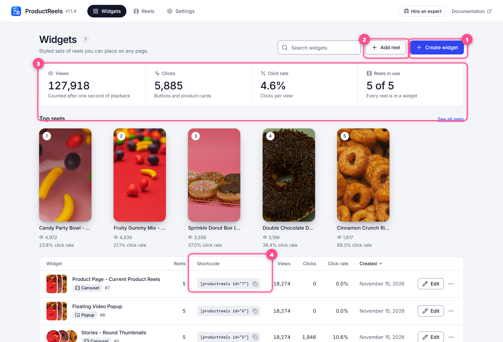
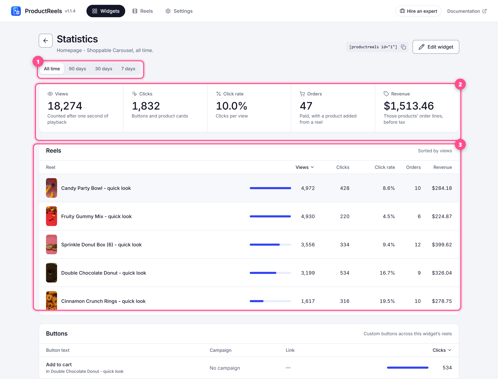
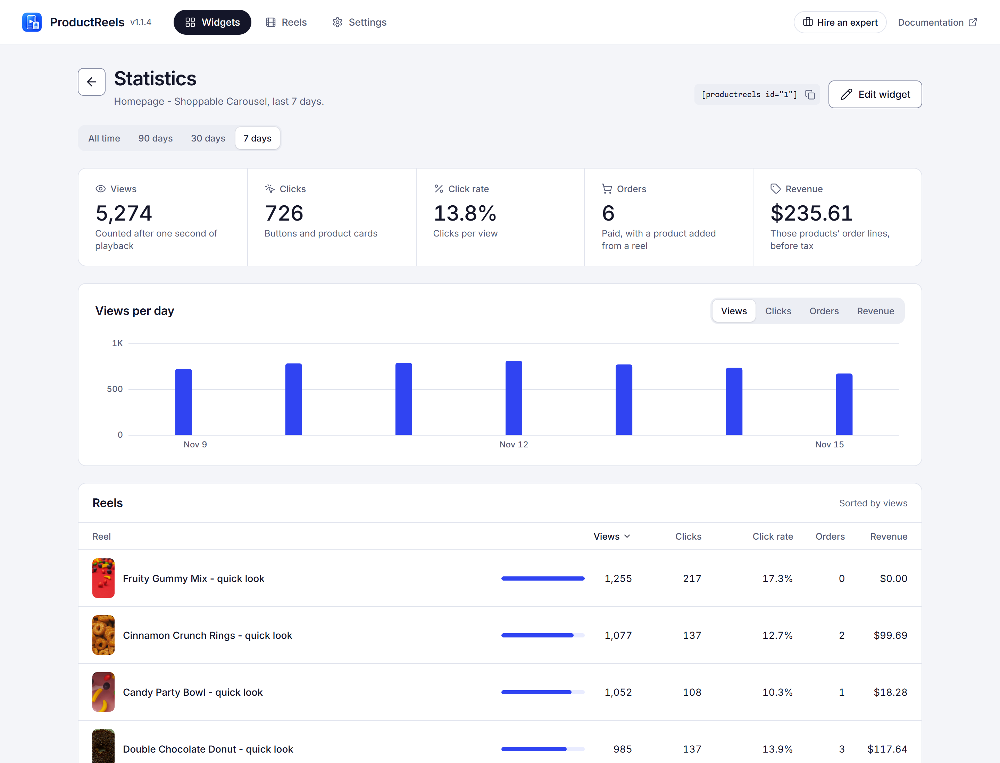

# Statistics

ProductReels measures how each widget and reel performs, from first view to paid order.


The numbers in the screenshots on this page are **demo data** from a test store.


## Where to find it

* **All widgets:** the totals at the top of **ProductReels → Widgets**.
* **One widget:** on **ProductReels → Widgets**, open the **⋯** menu at the end of the widget's row and choose **Statistics**.

<figure><figcaption>
<strong>3</strong> Totals across all widgets, plus your top reels.
</figcaption></figure>

## A widget's statistics

<figure><figcaption>
<strong>1</strong> Date range · <strong>2</strong> Totals · <strong>3</strong> Per-reel breakdown.
</figcaption></figure>

### Date range

Choose **All time**, **90 days**, **30 days** or **7 days**.

<figure><figcaption>
The same widget over the last 7 days.
</figcaption></figure>

### What each number means

| Metric | Meaning |
| --- | --- |
| **Views** | Counted after **one second of playback**. Refreshes by the same visitor are limited (see [Settings](settings.md#view-tracking)). |
| **Clicks** | Clicks on **buttons and product cards**. |
| **Click rate** | Clicks per view. |
| **Orders** | **Paid** orders with a product that was added to the cart from a reel. |
| **Revenue** | The order lines of those products, **before tax**. |


**Cancelled, refunded and failed orders are excluded** from orders and revenue. Only eligible paid orders count.


### Reels table

Every reel in the widget is listed with its own views, clicks, click rate, orders and revenue, sorted by views. Use it to see which videos earn their place.

### Buttons table

Below the reels, the **Buttons** table lists your custom buttons with their **campaign name**, link and clicks. Give buttons a campaign name when you add them (see [Reels → Add a button](reels.md#shop-this-reel)) to compare campaigns.

## Privacy

ProductReels does not send visitor data to ProductReels servers. For view limiting, visitor IP addresses are hashed and are never stored in the analytics tables. See [Privacy](privacy.md).


### Need help? Chat live or hire an expert

Our team at BestWebExpert is ready to help: **[start a live chat](https://bestwebexpert.com/)** or **[hire BestWebExpert](https://bestwebexpert.com/)** to set up, style or extend ProductReels for you.

