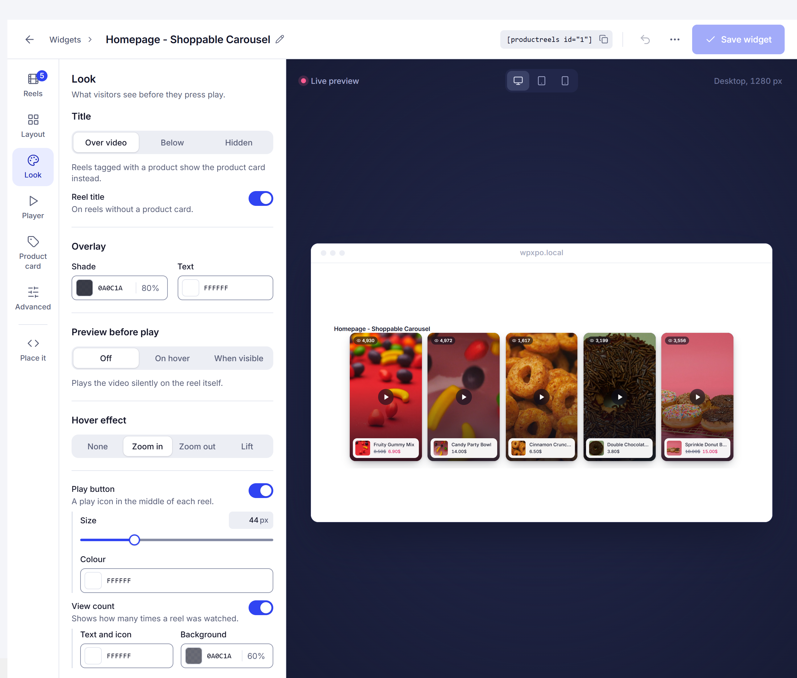
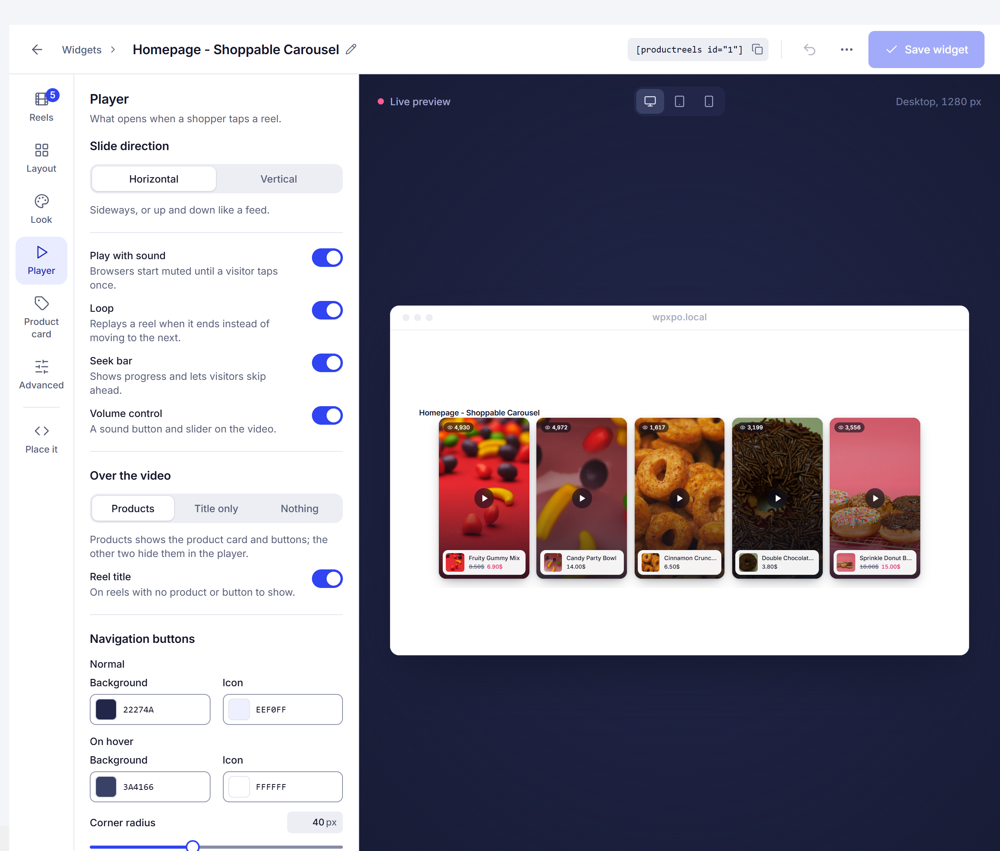
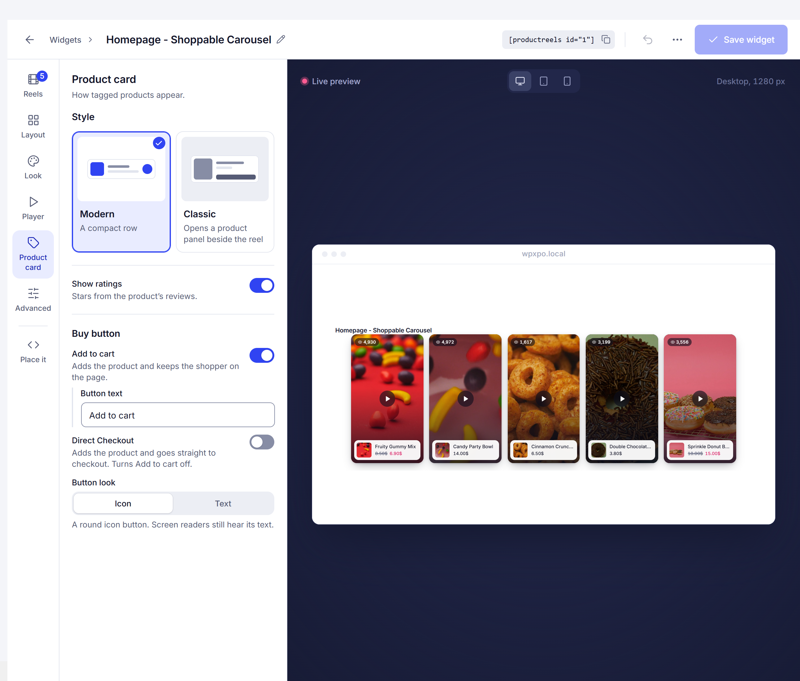
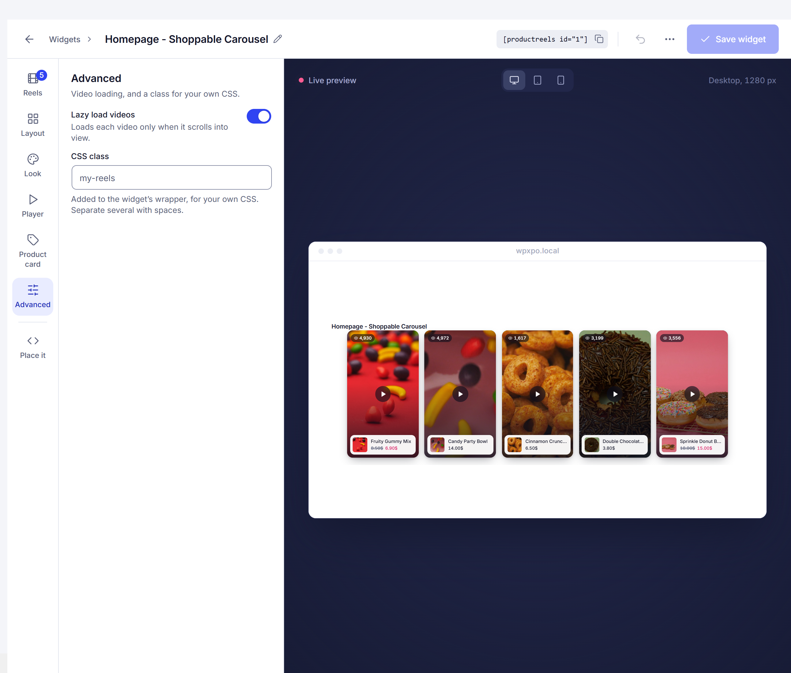

# Styling and player options

Every visual setting lives in the widget editor and updates the live preview instantly. This page walks through each step.

## Look

What visitors see **before** they press play.

<figure><figcaption><p>The <strong>Look</strong> step.</p></figcaption></figure>

| Setting | Options |
| --- | --- |
| **Title** | **Over video**, **Below** the reel, or **Hidden**. |
| **Reel title** | Show a title on reels that have no product card. |
| **Overlay** | The **shade** color and opacity behind text, and the **text** color. |
| **Preview before play** | **Off**, **On hover** or **When visible**: plays the video silently on the reel itself. |
| **Hover effect** | **None**, **Zoom in**, **Zoom out** or **Lift**. |
| **Play button** | Show or hide the play icon, with its size and color. |

Further down the step you can also style the **view counter** badge, the reel **border**, **corner radius** and **shadow**, and the **widget title**.

## Player

What opens when a shopper taps a reel. See [The shopper experience](shopper-experience.md) to see it in action.

<figure><figcaption><p>The <strong>Player</strong> step.</p></figcaption></figure>

| Setting | What it does |
| --- | --- |
| **Slide direction** | **Horizontal** (sideways) or **Vertical** (up and down, like a feed). |
| **Play with sound** | Browsers start muted until a visitor taps once. |
| **Loop** | Replay a reel when it ends instead of moving to the next. |
| **Seek bar** | Show progress and let visitors skip ahead. |
| **Volume control** | A sound button and slider on the video. |
| **Over the video** | **Products** shows the product card and buttons. **Title only** and **Nothing** hide them. |
| **Navigation buttons** | Background and icon colors, normal and hover. |


Carousel arrows (in the layout, not the player) also have their own colors, corner radius and a position setting: **inside** or **outside** the row.


## Product card

How tagged products appear on the reel.

<figure><figcaption><p>The <strong>Product card</strong> step.</p></figcaption></figure>

| Setting | What it does |
| --- | --- |
| **Style** | **Modern**: a compact row on the video. **Classic**: opens a product panel beside the reel. |
| **Show ratings** | Show stars from the product's reviews. |
| **Add to cart** | Adds the product and **keeps the shopper on the page**. Set your own **Button text**. |
| **Direct Checkout** | Adds the product and **goes straight to checkout**. This turns Add to cart off. Set its own button text. |
| **Button look** | **Icon** (a round button; screen readers still hear its text) or **Text**. |

## Advanced

<figure><figcaption><p>The <strong>Advanced</strong> step.</p></figcaption></figure>

| Setting | What it does |
| --- | --- |
| **Lazy load videos** | Loads each video only when it scrolls into view. Keeps pages fast. Recommended. |
| **CSS class** | Adds your class to the widget wrapper so you can style it with your own CSS. Separate several classes with spaces. |

```css
/* Example: soften the shadow on one widget */
.my-reels .prs-tile {
  box-shadow: 0 6px 18px rgba(0, 0, 0, 0.12);
}
```


Class names such as `.prs-tile` belong to the plugin's markup and may change between versions. Prefer your own CSS class on the wrapper and test after plugin updates.



### Need help? Chat live or hire an expert

Our team at BestWebExpert is ready to help: **[start a live chat](https://bestwebexpert.com/)** or **[hire BestWebExpert](https://bestwebexpert.com/)** to set up, style or extend ProductReels for you.

