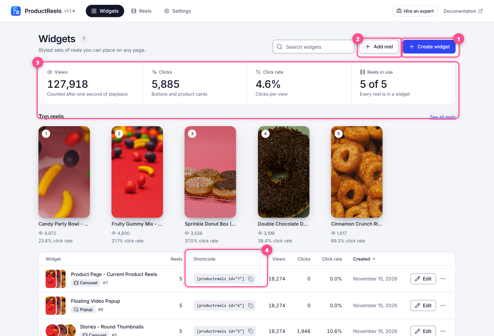

# Support and hiring BestWebExpert

ProductReels is built by **BestWebExpert**. If you need help, there is a real team behind it.


### Need help? Go to our main website

**[bestwebexpert.com](https://bestwebexpert.com/)**: **live chat is available.** Ask a question, get unstuck, or tell us what you want to build.


## Ways to get help

<table data-view="cards"><thead><tr><th></th><th></th><th data-hidden data-card-target data-type="content-ref"></th></tr></thead><tbody><tr><td><strong>Live chat</strong></td><td>Chat with the team at bestwebexpert.com for quick answers.</td><td><a href="https://bestwebexpert.com/">https://bestwebexpert.com/</a></td></tr><tr><td><strong>Hire BestWebExpert</strong></td><td>Let us set up, style or extend ProductReels for you.</td><td><a href="https://bestwebexpert.com/">https://bestwebexpert.com/</a></td></tr><tr><td><strong>FAQ and troubleshooting</strong></td><td>Fast fixes for the most common problems.</td><td><a href="faq.md">faq.md</a></td></tr></tbody></table>

## When to hire BestWebExpert


**[Hire BestWebExpert](https://bestwebexpert.com/)** when you want it done properly and fast.


* **Store setup:** shoppable reels set up across your WooCommerce store, product by product.
* **Custom design:** reels styled to match your brand and theme.
* **Conversion work:** layout, placement and product-card tuning to lift clicks and sales.
* **Integrations:** custom features, tracking and connections to other tools.
* **WordPress and WooCommerce:** performance, migrations, fixes and ongoing care.

## See it in action

* [Live demo](https://bestwebexpert.com/productreels/)
* [Reel layouts](https://bestwebexpert.com/reel-layouts/)
* [Shop the look](https://bestwebexpert.com/shop-the-look/)
* [Lookbook](https://bestwebexpert.com/lookbook/)

You can also reach the team from inside WordPress: the **Hire an expert** button in the ProductReels admin header links straight to us.

<figure><figcaption>
The <strong>Hire an expert</strong> button sits in the top-right of every ProductReels screen.
</figcaption></figure>


**Ready to start?** Open **[bestwebexpert.com](https://bestwebexpert.com/)** and use the **live chat**.

