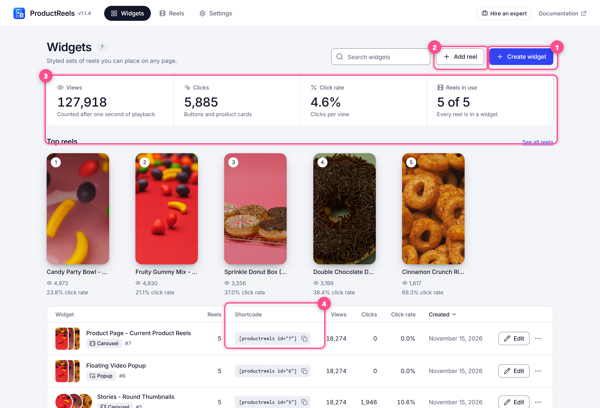
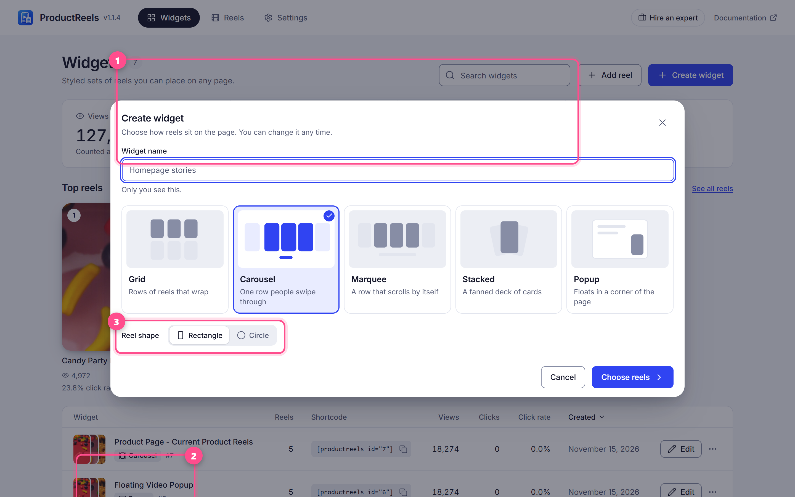
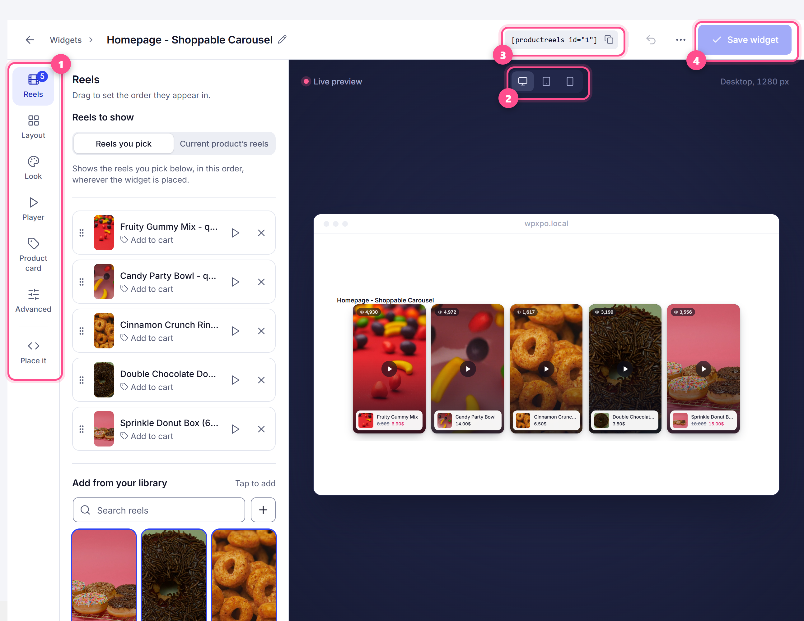
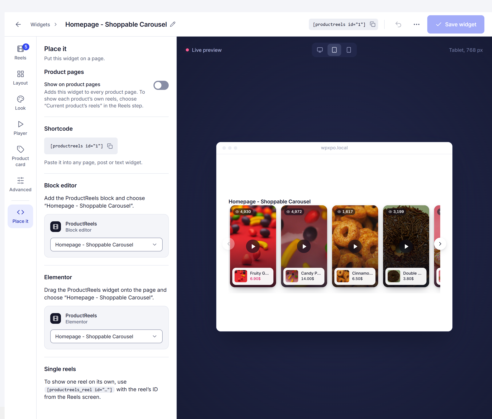
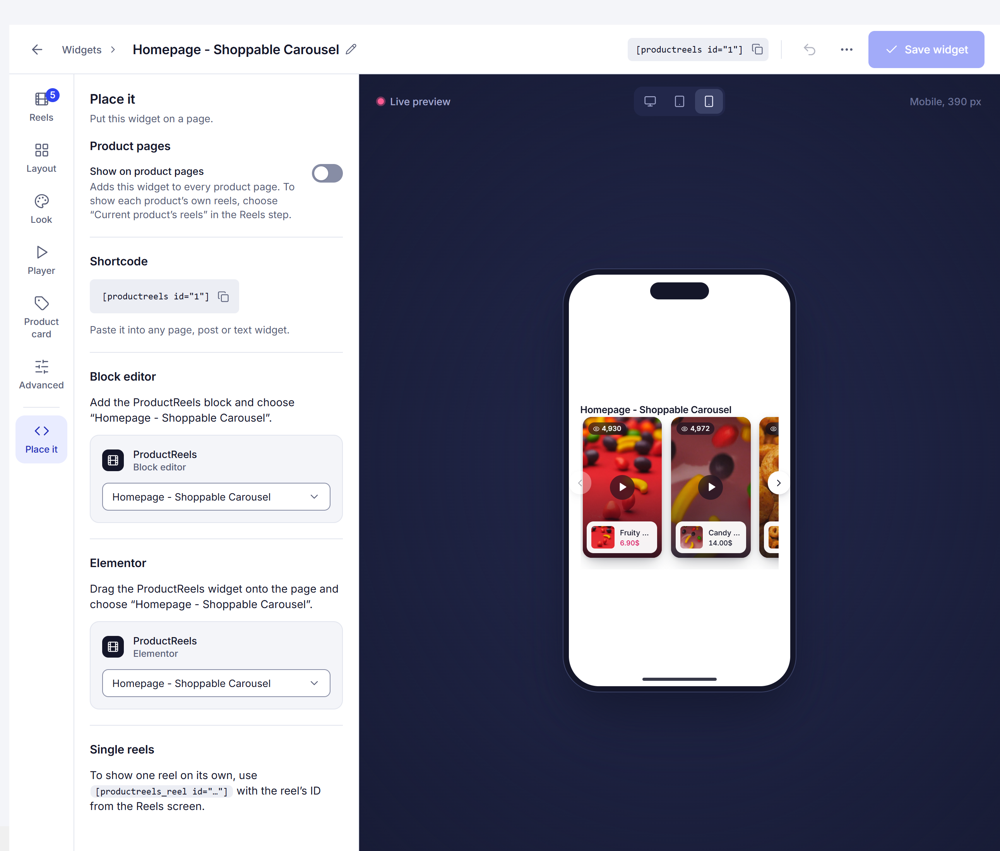

# Widgets

A **widget** is a styled collection of reels. It decides *which* reels appear, *how* they are laid out and what they look like. Each widget has its own shortcode.

## The Widgets screen

<figure><figcaption>
<strong>1</strong> Create widget · <strong>2</strong> Add reel · <strong>3</strong> Totals across all widgets · <strong>4</strong> Shortcode column.
</figcaption></figure>

* **Totals**: views, clicks, click rate and how many of your reels are in use.
* **Top reels**: your best performing videos at a glance.
* **Widgets table**: name, layout, number of reels, shortcode, views, clicks, click rate and created date. Click the copy icon next to a shortcode to copy it. Use **Edit** to open the editor. The **⋯** menu on each row has **Statistics**, **Duplicate** and **Delete widget**.

## Create a widget

Click **Create widget**.

<figure><figcaption>
<strong>1</strong> Widget name · <strong>2</strong> Layout · <strong>3</strong> Reel shape.
</figcaption></figure>

1. **Widget name**: only you see this, so pick something that helps you recognize it (for example *Homepage stories*).
2. **Layout**: Grid, Carousel, Marquee, Stacked or Popup. See [Layouts](layouts.md).
3. **Reel shape**: Rectangle or Circle (for story-style thumbnails).
4. Click **Choose reels**, pick the reels to show and continue to the editor.

## The widget editor

<figure><figcaption>
<strong>1</strong> Settings steps · <strong>2</strong> Device preview · <strong>3</strong> Shortcode · <strong>4</strong> Save widget.
</figcaption></figure>

The editor has a settings panel on the left and a **live preview** on the right. Every change you make appears in the preview straight away.

### The seven steps

| Step | What you control | Learn more |
| --- | --- | --- |
| **Reels** | Which reels appear and in what order. | [Below](widgets.md#reels-step) |
| **Layout** | Layout, shape, sizes, spacing and layout-specific options. | [Layouts](layouts.md) |
| **Look** | Titles, overlays, hover effects, play button, borders. | [Styling](styling.md#look) |
| **Player** | The fullscreen player. | [Styling](styling.md#player) |
| **Product card** | How tagged products appear and the buy button. | [Styling](styling.md#product-card) |
| **Advanced** | Lazy loading and a custom CSS class. | [Styling](styling.md#advanced) |
| **Place it** | Shortcode, block, Elementor and product pages. | [Placing widgets](placing-widgets.md) |

### Reels step

<figure><figcaption>
The Reels step lists the reels in this widget.
</figcaption></figure>

* **Reels to show**: choose **Reels you pick** (a fixed list, shown in the order you set) or **Current product's reels** (see [WooCommerce product pages](product-pages.md)).
* **Reorder**: drag the handle on any reel.
* **Preview**: the play button plays a reel inside the editor.
* **Remove**: the **×** takes a reel out of this widget without deleting it from your library.
* **Add from your library**: search and tap a reel to add it. The **+** button creates a brand new reel without leaving the editor.

### Preview on every device

Switch between **Desktop**, **Tablet** and **Mobile** above the preview. Sizes and gaps can be set per device, so you can have smaller reels on phones.



<figure><figcaption>
Tablet preview.
</figcaption></figure>



<figure><figcaption>
Mobile preview.
</figcaption></figure>



### Saving

Click **Save widget**. If you leave with unsaved changes, ProductReels warns you first. Use the **undo** button to discard changes, and the **⋯** menu to duplicate or delete a widget.


Saving a widget clears its cache, so changes show on your site straight away. See [Settings → Performance](settings.md#performance).



### Need help? Chat live or hire an expert

Our team at BestWebExpert is ready to help: **[start a live chat](https://bestwebexpert.com/)** or **[hire BestWebExpert](https://bestwebexpert.com/)** to set up, style or extend ProductReels for you.

